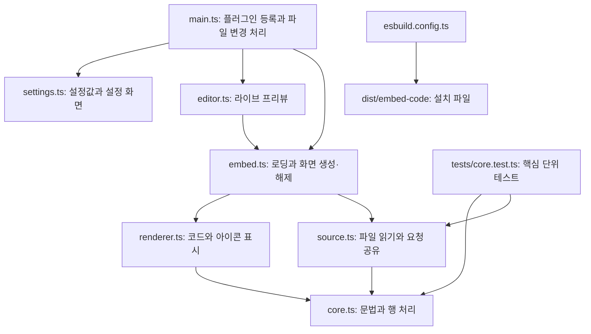
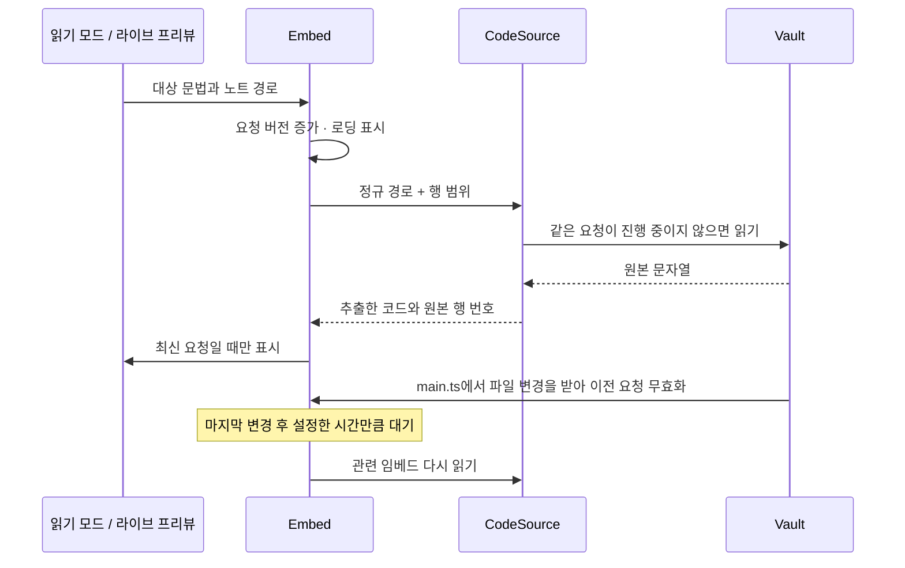

# Embed Code 아키텍처

Vault 내부 코드 파일을 읽기 모드와 라이브 프리뷰에 표시하는 TypeScript·pnpm 프로젝트다. 구조를 변경하기 전에 이 문서를 먼저 수정한다.

## 구성

- `main.ts`는 각 모듈을 등록하고 파일 변경 후 갱신할 임베드를 찾는다.
- `settings.ts`는 기본 설정, 지원 확장자 확인, 설정 화면을 담당한다. 자동 갱신 대기 시간은 `refreshDelayMs`에 저장하며 기본값은 300ms다. 0 이상인 정수만 허용하고 타이머가 지원하는 최댓값을 넘으면 기본값을 사용한다. 변경한 값은 다음 파일 변경부터 적용한다.
- `editor.ts`는 라이브 프리뷰의 문법을 위젯으로 바꾸고 위젯이 사라질 때 임베드도 해제한다.
- `embed.ts`는 로딩과 오류를 표시하고 최신 읽기 결과만 화면에 반영한다.
- `renderer.ts`는 구문 강조, 행 번호, 줄바꿈, 아이콘을 표시한다.
- `source.ts`는 Vault 파일을 읽고 같은 경로와 행 범위의 진행 중인 요청을 공유한다.
- `core.ts`는 Obsidian에 의존하지 않는다. `LineRange`, `EmbedTarget`, `CodeSnippet`으로 입력과 추출 결과를 나타낸다. 행을 나눌 때 원본 줄바꿈을 보존한다.
- 경로는 임베드가 있는 노트의 폴더 기준이다. `/`로 시작하면 Vault 루트 기준이다. Vault 밖의 경로나 URL은 허용하지 않는다.
- 행 번호는 1부터 시작하고 양끝을 포함한다. 시작 행이 파일 끝을 넘으면 오류를 표시하고, 끝 행만 넘으면 마지막 행까지 읽는다. 마지막 줄바꿈은 추가 행으로 세지 않으며 빈 파일은 빈 첫 행으로 취급한다.

## 읽기와 갱신

- 진행 중인 요청만 공유한다. 변경된 파일의 요청만 무효화하고, 이전 응답은 요청 버전으로 차단한다.
- 기본 파일 임베드와 충돌하지 않도록 라이브 프리뷰 치환을 높은 우선순위로 등록한다. 단독 행은 블록 위젯으로 표시하고 커서가 문법에 들어오면 편집할 수 있게 한다. 소스 모드는 치환하지 않는다.
- 코드를 한 번 강조하고, 줄바꿈과 행 번호를 함께 표시할 때는 강조된 DOM을 행별로 복제한다. 여러 줄 주석·문자열의 강조 문맥을 유지하기 위한 처리다.
- 표시 설정 변경은 기존 임베드만 갱신한다. 활성화 여부·지원 확장자 변경은 임베드 대상이 바뀌므로 읽기 화면과 에디터 치환을 다시 구성한다.
- `renderVersion`으로 오래된 응답을 걸러내고 `isUnloaded`로 화면이 닫혔는지 확인한다. 화면을 닫으면 구독과 ResizeObserver를 해제하고, 플러그인을 끄면 타이머도 정리한다.

## 화면 조작

파일명 오른쪽에 Obsidian 내장 아이콘 버튼으로 복사와 원본 열기를 배치한다. `setIcon`·`setTooltip`과 접근성 이름을 사용하고, 별도 버튼 줄은 만들지 않는다. 코드 배경과 모서리는 Obsidian 테마 변수를 따른다. 제목을 누르면 코드를 접거나 펼친다.

## 포맷팅

Prettier를 사용하며 들여쓰기는 탭 문자 대신 공백 4칸으로 통일한다. `pnpm format`은 코드와 문서를 정리하고 `pnpm format:check`는 형식만 검사한다. 빌드 산출물과 의존성 잠금 파일은 제외한다.

## 빌드와 검증

플러그인 ID와 설치 폴더 이름은 `embed-code`로 통일한다. 배포 ZIP은 `dist/embed-code.zip`에 둔다.

`pnpm build`는 미사용 변수·매개변수를 포함한 TypeScript 검사 후 설치 파일을 `dist/embed-code/`에 생성한다. `pnpm dev`도 같은 경로를 사용한다. Obsidian과 CodeMirror는 호스트가 제공하므로 번들에서 제외한다.

`pnpm test`는 행 범위, 원문 보존, 동시 요청 공유에 관한 핵심 단위 테스트만 실행한다.
