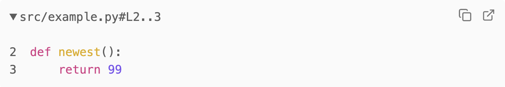

# Embed Code

Vault 내부 코드 파일의 전체 내용이나 지정한 행을 Obsidian 노트에 표시합니다. 읽기 모드와 라이브 프리뷰를 지원합니다.

## 설치

ZIP 파일은 압축을 풀고 `embed-code` 폴더를 Vault의 `.obsidian/plugins/`에 넣으세요. Obsidian을 다시 불러온 뒤 커뮤니티 플러그인에서 **Embed Code**를 활성화하세요.

직접 빌드하려면 Node.js 24.15 이상과 `package.json`에 지정된 pnpm 버전을 사용하세요.

```sh
pnpm install --frozen-lockfile
pnpm build
```

생성된 `dist/embed-code/` 폴더를 Vault의 `.obsidian/plugins/`에 복사하세요. 설치에 필요한 파일은 `main.js`, `manifest.json`, `styles.css` 세 개입니다.

## 사용

```markdown
![[src/example.py]]
![[src/example.py#L10]]
![[src/example.py#L10..30]]
```

`![[src/example.py#L2..3]]`을 표시한 예시입니다.



- 상대 경로는 노트가 있는 폴더 기준입니다. `notes/note.md`에서 `src/example.py`는 `notes/src/example.py`를 가리킵니다.
- `/src/example.py`는 Vault 루트 기준입니다. `../`를 사용할 수 있지만 Vault 밖으로 나갈 수는 없습니다.
- 행 번호는 1부터 시작하고 양끝을 포함합니다. 시작 행 초과, 0 이하, 역순 범위, 잘못된 문법은 오류입니다. 끝 행만 초과하면 마지막 행까지 표시합니다.
- 공백·들여쓰기·줄바꿈을 보존합니다. 마지막 줄바꿈은 추가 행으로 세지 않으며 빈 파일은 빈 첫 행으로 취급합니다.

## 지원 언어·확장자

기본 지원 확장자는 다음과 같습니다. 설정에서 추가하거나 제외할 수 있습니다.

| 언어·형식             | 확장자                               |
| --------------------- | ------------------------------------ |
| Python                | `py`                                 |
| JavaScript·TypeScript | `js`, `jsx`, `ts`, `tsx`             |
| HTML·CSS·SCSS         | `html`, `css`, `scss`                |
| Java·Kotlin·Swift     | `java`, `kt`, `swift`                |
| C·C++·C#              | `c`, `h`, `cpp`, `hpp`, `cs`         |
| Go·Rust·Ruby·PHP      | `go`, `rs`, `rb`, `php`              |
| Shell                 | `sh`, `bash`                         |
| SQL                   | `sql`                                |
| 데이터·설정 파일      | `json`, `yaml`, `yml`, `toml`, `xml` |
| Markdown·일반 텍스트  | `md`, `txt`                          |

파일 확장자로 언어를 판별합니다. Obsidian에 해당 Prism 문법이 로드되어 있으면 구문을 강조하고, 없으면 일반 텍스트로 표시합니다. 확장자 추가만으로 새로운 구문 강조 문법이 설치되지는 않습니다.

## 설정과 조작

설정 → Embed Code에서 활성화 여부, 지원 확장자, 원본 행 번호, 기본 접힘, 긴 행 줄바꿈, 자동 갱신 대기 시간을 변경합니다.

- 제목을 누르면 코드를 접고 펼칩니다.
- 파일명 오른쪽 **복사 아이콘**은 표시 구간의 원문을 복사합니다.
- **원본 열기 아이콘**은 Vault 내부 원본 파일을 엽니다. 아이콘에 마우스를 올리면 툴팁을 표시합니다.

라이브 프리뷰에서 커서를 임베드 안에 두면 문법을 편집할 수 있습니다. 소스 모드는 문법 그대로 표시합니다. 설정에서 확장자를 제외하면 Obsidian의 기본 임베드로 표시합니다.

원본 파일이 바뀌면 마지막 변경 후 설정한 시간만큼 기다렸다가 관련 임베드를 갱신합니다. **자동 갱신 대기 시간 (ms)**의 기본값은 300ms이며 0 이상의 정수를 입력할 수 있습니다. 변경한 값은 다음 파일 변경부터 적용합니다. 같은 파일의 같은 행 범위를 동시에 요청하면 읽기 결과를 공유합니다. 이전 응답이 최신 표시를 덮어쓰지 않도록 합니다.

## 개발

TypeScript와 pnpm을 사용하며, 들여쓰기는 공백 4칸으로 통일합니다.

- `pnpm dev`: `dist/embed-code/`에 자동 빌드. 스타일·manifest 변경은 다시 실행해야 합니다.
- `pnpm build`: TypeScript 검사 및 `dist/embed-code/` 생성
- `pnpm test`: 행 범위·원문 보존·동시 요청 공유 핵심 테스트
- `pnpm format`: Prettier로 코드·문서 자동 포맷팅
- `pnpm format:check`: 파일을 수정하지 않고 포맷 검사

구조 변경 전 [ARCHITECTURE.md](ARCHITECTURE.md)를 먼저 수정하세요.

## 자동 릴리즈

`main`에 push하면 GitHub Actions가 포맷 검사, 테스트, 빌드를 실행합니다. 검사를 통과하면 마지막 릴리즈 이후 커밋으로 다음 버전을 정합니다.

| 커밋 예시                                                     | 버전 변경                 |
| ------------------------------------------------------------- | ------------------------- |
| `fix: 행 번호 오류 수정`                                      | 패치: `1.0.0` → `1.0.1`   |
| `feat: 새 표시 옵션 추가`                                     | 마이너: `1.0.0` → `1.1.0` |
| `feat!: 임베드 문법 변경` 또는 본문에 `BREAKING CHANGE:` 포함 | 메이저: `1.0.0` → `2.0.0` |
| `docs:`, `chore:`, `refactor:` 등만 있는 경우                 | 릴리즈 생략               |

처음 배포할 버전은 `1.0.0`입니다. 여러 변경을 한 번에 push하면 가장 큰 버전 변경을 적용합니다. PR을 squash merge한다면 최종 커밋 제목도 위 규칙에 맞춰 작성하세요.

릴리즈 시 다음 작업을 자동으로 처리합니다.

- `package.json`과 `manifest.json`의 버전을 맞추고 `versions.json`에 최소 Obsidian 버전을 기록합니다.
- `CHANGELOG.md`와 버전 파일을 자동 커밋합니다. 버전은 직접 올리지 않아도 됩니다.
- `v` 없는 버전 태그와 GitHub Release를 만들고 `main.js`, `manifest.json`, `styles.css`, `embed-code.zip`을 첨부합니다.

[GitHub Releases](https://github.com/hepheir/obsidian-embed-code/releases)에서 배포 파일을 받으세요. ZIP에는 `embed-code/` 설치 폴더가 들어 있습니다.

자동화는 저장소에서 제공하는 `GITHUB_TOKEN`을 사용합니다. 별도 개인 토큰은 필요하지 않습니다. 브랜치 보호 규칙으로 봇의 `main` push를 막으면 자동 커밋 단계가 실패하므로 해당 저장소 정책을 확인해야 합니다.

실패한 경우 GitHub의 **Actions → Release**에서 오류를 확인하세요. 원인을 수정한 뒤 작업을 다시 실행할 수 있습니다. 실패한 작업이 이미 태그나 Release를 만들었다면 기존 상태를 먼저 확인하고, 누락된 첨부 파일은 같은 릴리즈에 올려 복구하세요. `pnpm release --dry-run`은 버전 판정만 확인하며 파일 갱신이나 릴리즈 게시는 하지 않습니다.

## 코드 블록을 파일로 추출

라이브 프리뷰 또는 읽기 화면에서 일반 코드 블록이나 Mermaid 렌더링 결과를 우클릭하고 **파일로 추출…**을 선택하세요. 원본 fenced 코드 블록을 정확히 식별할 수 있는 경우에 메뉴가 표시됩니다. 소스 모드와 들여쓰기 코드 블록은 지원하지 않습니다.

파일명과 확장자를 포함한 경로를 입력하면 코드 내용을 저장하고 원래 블록을 `![[/경로]]`로 치환합니다. 상대 경로는 노트 폴더 기준이며 `/`로 시작하면 Vault 루트 기준입니다. 없는 폴더는 생성합니다. 기존 파일은 덮어쓰기 확인을 받으며, 취소하면 경로 입력으로 돌아갑니다. 저장 확장자는 플러그인 설정의 지원 확장자에 포함되어야 합니다.

Mermaid에는 `.mmd`를 제안합니다. `.mmd`는 기본 지원 확장자에 추가되며 기존 설정에도 한 번 추가됩니다. 추출 후에는 다이어그램 대신 Mermaid 원문 코드가 임베드됩니다. 코드가 변경되면 추출을 중단합니다. 파일 저장 후 노트 치환에 실패하면 저장된 경로를 안내합니다.

열린 노트에서 실행 취소하면 노트 치환만 되돌립니다. 생성하거나 덮어쓴 파일은 유지됩니다. 아이콘 버튼은 제공하지 않습니다.
